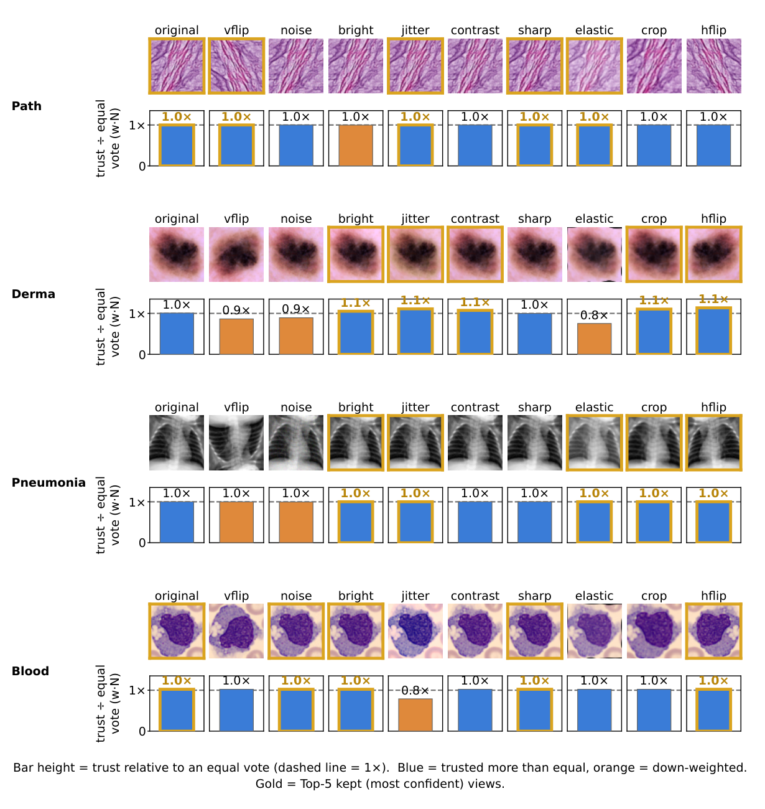
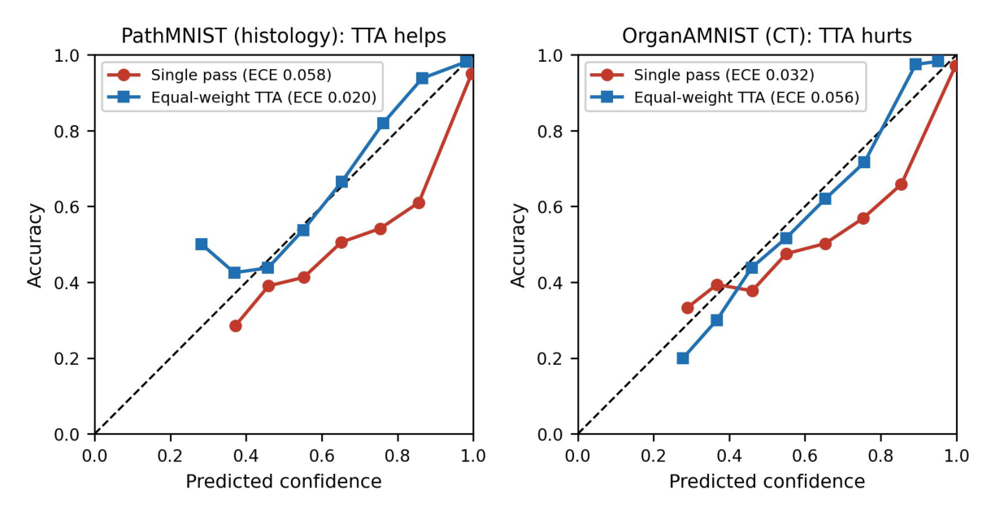
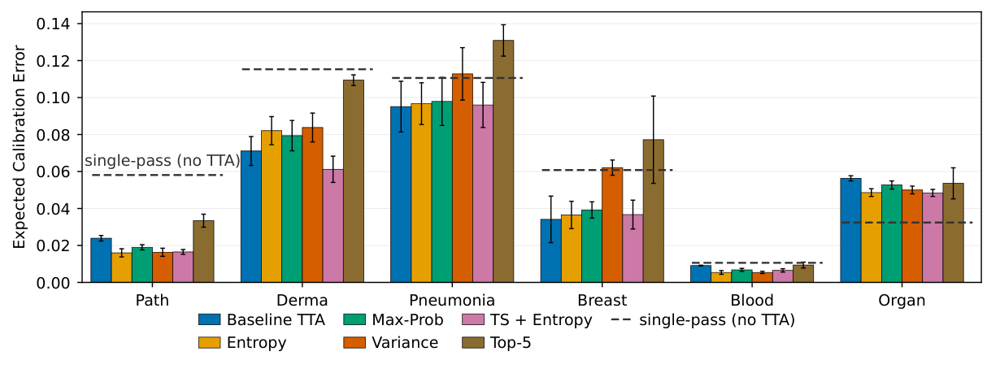
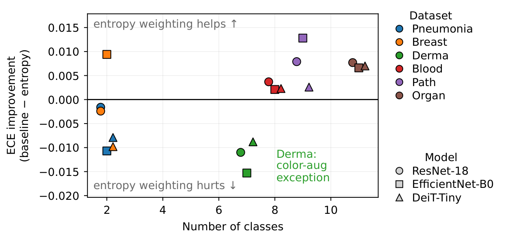
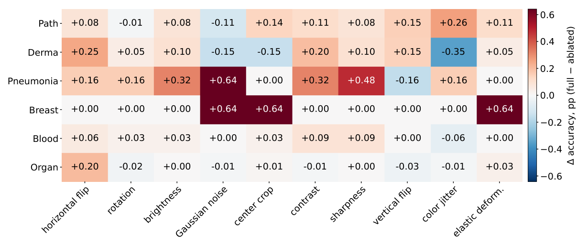

<div align="center">

# When Does Test-Time Augmentation Help Calibration?

### A Visual, Modality-Stratified Study for Medical Image Classification

**Mohamed Hafez<sup>1†</sup>, Mustafa Eren Soyhan<sup>1†</sup>, Mohamed Ahmed<sup>1†</sup>, Sudha Rajendran<sup>1</sup>, Thuy Trang Cao<sup>1</sup>, Vaidehiben Patel<sup>1</sup>, Khalid Elgazzar<sup>1,2</sup>**

<sup>1</sup>IoT Research Laboratory, Ontario Tech University, Oshawa, Canada &nbsp;·&nbsp; <sup>2</sup>Canadian University Dubai, UAE<br>
<sup>†</sup>Equal contribution

*Vision, Modeling, and Visualization (VMV) 2026* · The Eurographics Association

[](https://diglib.eg.org/handle/10.2312/vmv20261020)
[](https://doi.org/10.2312/vmv20261020)
[](LICENSE)
[](https://creativecommons.org/licenses/by/4.0/)


[**Paper**](https://diglib.eg.org/handle/10.2312/vmv20261020) ·
[**Supplementary**](https://diglib.eg.org/handle/10.2312/vmv20261020) ·
[**Poster**](docs/poster.pdf) ·
[**Slides**](docs/presentation.pdf) ·
[**Citation**](#citation)

<br>



<sub><b>Augmentation Confidence Strips (paper Fig. 1).</b> For one test image per modality, each bar shows how much the entropy-weighted ensemble trusts an augmented view relative to an equal vote (dashed line = 1×). Gold outlines mark the Top-5 most confident views. BloodMNIST, for example, down-weights color jitter to 0.8×.</sub>

</div>

---

## TL;DR

Test-time augmentation (TTA) is usually judged by accuracy. We look at **calibration**: does the model's confidence match how often it is right? Across **6 MedMNIST datasets, 3 backbones, 3 seeds and 9 fusion strategies**, we find:

1. **Plain equal-weight TTA can help or hurt calibration. The sign depends on the model's starting calibration.** It significantly lowers ECE on overconfident modalities (histology, dermoscopy, chest X-ray) and significantly raises it on the one well-calibrated modality (abdominal CT), on every backbone.
2. **Entropy weighting cuts ECE by up to 41%** (BloodMNIST) and 33% (PathMNIST) versus equal-weight TTA, with no significant change in accuracy.
3. **Temperature-scaled entropy weighting (TS+Entropy) is the safest default.** It gets the lowest NLL (including one tie) in **14 of 18** model-dataset cases.
4. **Augmentation Confidence Strips** make the hidden fusion weights visible, so you can see which augmentations the model distrusts in each modality.

Everything after training is **inference-only on a frozen model**. No retraining or parameter updates are needed, so it fits pre-certified medical systems.

---

## Contents

- [Key results](#key-results)
- [Which fusion strategy should I use?](#which-fusion-strategy-should-i-use)
- [Method](#method)
- [Datasets](#datasets)
- [Installation](#installation)
- [Running the code](#running-the-code)
- [Reproducing the paper](#reproducing-the-paper)
- [Repository structure](#repository-structure)
- [Project context and team](#project-context-and-team)
- [Citation](#citation)
- [License and acknowledgements](#license-and-acknowledgements)

---

## Key results

### 1. The calibration sign flip

<p align="center">
  
</p>
<p align="center"><sub><b>Paper Fig. 4.</b> ResNet-18, pooled over three seeds. On overconfident histology, TTA pulls the curve onto the diagonal (ECE 0.058 → 0.020). On already well-calibrated CT, it pushes the curve off (ECE 0.032 → 0.056).</sub></p>

Paired bootstrap of **ΔECE = ECE(equal-weight TTA, N=10) − ECE(single pass)** on the pooled three-seed test set (2,000 resamples). Negative means TTA helps; positive means it hurts. `*` marks a 95% CI that excludes zero.

| Dataset (modality) | ResNet-18 | EfficientNet-B0 | DeiT-Tiny |
|---|---:|---:|---:|
| PathMNIST (histology) | −0.038\* | −0.000 | −0.028\* |
| DermaMNIST (dermoscopy) | −0.041\* | −0.043\* | −0.036\* |
| PneumoniaMNIST (chest X-ray) | −0.025\* | −0.023\* | −0.016\* |
| BreastMNIST (ultrasound) | −0.043\* | +0.043 | −0.037\* |
| BloodMNIST (blood microscopy) | −0.002 | −0.004\* | −0.008\* |
| **OrganAMNIST (abdominal CT)** | **+0.024\*** | **+0.029\*** | **+0.022\*** |

15 of 18 comparisons are significant. The three that are not are already near-perfectly calibrated (BloodMNIST/ResNet-18, PathMNIST/EfficientNet-B0) or too small to resolve (156-image BreastMNIST/EfficientNet-B0).

### 2. Uncertainty-aware fusion improves calibration, not accuracy

<p align="center">
  
</p>
<p align="center"><sub><b>Paper Fig. 2.</b> ECE by dataset and fusion strategy (ResNet-18, mean ± std over 3 seeds). Dashed lines are single-pass (no TTA) ECE. Other backbones are in the supplementary material.</sub></p>

- **Entropy vs. equal-weight TTA (ResNet-18):** ECE −41% on BloodMNIST and −33% on PathMNIST. The reduction holds on all three seeds, and the 95% bootstrap interval is entirely below zero (PathMNIST [−0.012, −0.006], BloodMNIST [−0.005, −0.003]). EfficientNet-B0 confirms it; on DeiT-Tiny, equal-weight TTA is already well calibrated there, so the extra gain is not significant.
- **Accuracy barely moves.** A Wilcoxon signed-rank test across the six datasets finds no significant change between the best per-dataset strategy and the single pass (ResNet-18 p = 0.17, EfficientNet-B0 p = 0.88, DeiT-Tiny p = 0.44). On the binary tasks, AUC-ROC stays essentially fixed across strategies.
- **TS+Entropy has the lowest NLL in 14 of 18 cases** (full ECE/NLL matrix in paper Table 4 and [`results/full_matrix.csv`](results/full_matrix.csv)).

### 3. Why it works: an informative signal *and* trustworthy augmentations

<p align="center">
  
</p>
<p align="center"><sub><b>Paper Fig. 3.</b> ECE improvement from entropy weighting vs. number of classes. Marker shape = backbone.</sub></p>

Entropy weighting helps when two conditions hold together:

- **The entropy signal is informative.** Since H(p) ≤ log C, the weights exp(−H) can differ by at most a factor of C: only 2× on a binary task, 9× on PathMNIST. Binary tasks therefore see weak, mixed effects.
- **The augmentations are trustworthy.** DermaMNIST is multi-class but color-diagnostic, so color augmentations corrupt the signal and plain entropy weighting hurts.

<p align="center">
  
</p>
<p align="center"><sub><b>Paper Fig. 5.</b> Augmentation importance: accuracy change (pp) when each augmentation is removed from the full pipeline (ResNet-18). Removing color jitter hurts DermaMNIST most (−0.35 pp).</sub></p>

### 4. Negative findings

- **Hard filtering (Top-K) is not a substitute for soft weighting.** Soft entropy weighting beats every Top-K filter (K ∈ {3, 5, 7}) on NLL in 17 of 18 cases. On PathMNIST, Top-5 reaches 0.035 ECE against 0.016 for soft weighting, at the same cost.
- **Inverse-variance weighting is unstable on small data.** On the 156-image BreastMNIST test set it rewards the most uncertain views and drops EfficientNet-B0 accuracy from 0.84 to 0.77 (−7 pp).

### 5. Inference cost

All soft strategies and Top-K reuse one set of per-view forward passes, so only the cheap fusion step differs. Measured in ms/image on an RTX 4080 Mobile:

| Method | ResNet-18 | EfficientNet-B0 | DeiT-Tiny |
|---|---:|---:|---:|
| Single forward pass (GPU compute) | 0.05 | 0.13 | 0.06 |
| TTA, end-to-end (N = 5) | 5.32 | 5.14 | 6.39 |
| TTA, end-to-end (N = 10) | 10.79 | 9.32 | 12.97 |
| MC-Dropout (T = 20) | 9.88 | 11.07 | 83.30 |

End-to-end TTA cost is dominated by the augmentation pipeline (about 1 ms per view), not the backbone. Calibrated TTA at N = 10 therefore costs roughly 10 ms per image on all three models, which is practical for edge and point-of-care devices.

---

## Which fusion strategy should I use?

Drawn from Section 6 of the paper:

| Your situation | Use | Why |
|---|---|---|
| No prior knowledge of the modality | **TS+Entropy** | Lowest NLL in 14 of 18 cases; the most consistent choice |
| Multi-class task (≈ 8+ classes) with diagnostically safe augmentations (e.g. histology, blood microscopy) | **Entropy** or **TS+Entropy** | Largest ECE gains (−33% to −41%) |
| Color-diagnostic modality (e.g. dermoscopy) | **TS+Entropy**, not plain entropy | Entropy alone worsens ECE 0.071 → 0.082; TS+Entropy brings it to 0.061 |
| Model is already well calibrated (e.g. abdominal CT) | **TS Only**; avoid equal-weight TTA | Equal-weight TTA raises ECE by +0.022 to +0.029 on every backbone |
| Binary task (e.g. chest X-ray, breast ultrasound) | **Choose on validation data** | Entropy gains are inconsistent; on chest X-ray, inverse-variance gave the lowest mean ECE |
| Very small test set | Avoid **inverse-variance** | Collapsed accuracy by 7 pp on BreastMNIST |
| Want to drop "bad" views | Prefer **soft weighting** over **Top-K** | Soft weighting wins on NLL in 17 of 18 cases |

---

## Method

Given a test image *x*, a frozen model *f* produces softmax outputs **p**₁ … **p**_N for N augmented views. Standard TTA averages them with equal weights 1/N. Uncertainty-weighted TTA gives each view a weight *wᵢ*, normalizes, and averages:

```
ŵᵢ = wᵢ / Σⱼ wⱼ        p̄ = Σᵢ ŵᵢ · pᵢ        (falls back to uniform if Σⱼ wⱼ ≈ 0)
```

| Strategy | Weight / definition | Intuition |
|---|---|---|
| Baseline TTA | wᵢ = 1/N | All views equal |
| Max-Prob | wᵢ = max(pᵢ) | Higher peak probability → more weight |
| Entropy | wᵢ = exp(−H(pᵢ)) | Lower entropy (more confident) → more weight |
| Variance | wᵢ = Var_k(pᵢ) | Peaked (confident) vectors → more weight |
| Inv-Variance | wᵢ = 1 / (Var_k(pᵢ) + ε) | Naive inverse; reported as a negative finding |
| MC-Dropout | T = 20 stochastic passes, mean | Epistemic uncertainty via test-time dropout |
| TS Only | softmax(z / T), no augmentation | Temperature-calibrated single pass |
| TS+Entropy | Entropy weighting on temperature-scaled logits | Calibrate first, then weight |
| Top-K (K ∈ {3, 5, 7}) | Keep the K lowest-entropy views, average | Hard filter (ablation) |

That gives 11 fusion configurations in total. Temperature *T* is fit per dataset on the validation split by L-BFGS on NLL. Dividing logits by *T* keeps the argmax, so accuracy is unchanged.

**Augmentation pool.** There are ten types: horizontal and vertical flip, rotation (±10°), brightness (±15%), Gaussian noise (σ = 0.01), center crop (90% then resize), contrast (±10%), color jitter (brightness/contrast/saturation ±10%, hue ±0.05), elastic deformation (α = 20, σ = 4), and sharpness (±20%). Each N = 10 ensemble uses the original image plus nine of these; the run seed picks which nine. Paper Table 2 rates each augmentation as Safe, Caution, or Avoid per modality. Fig. 5 shows these labels are best read as modality-informed priors, not hard rules.

**Pipeline.**

| Stage | What happens | Code |
|---|---|---|
| 1. Train | Fine-tune ResNet-18, EfficientNet-B0, or DeiT-Tiny from ImageNet weights; only the head is resized per dataset | `scripts.train_baseline`, `src/train.py` |
| 2. Augment | Generate N = 10 views of each test image | `src/augmentations.py` |
| 3. Weight and fuse | Per-view softmax → confidence weight → weighted average | `src/tta.py`, `scripts.run_weighted_tta` |
| 4. Calibrate | Fit T on the validation split and rescale logits | `src/temperature.py` |
| 5. Evaluate | Accuracy, AUC-ROC, ECE (10 equal-width bins), NLL, latency | `src/metrics.py`, `src/perf.py` |

Per-view logits are computed once and reused by every fusion strategy.

---

## Datasets

All data comes from **[MedMNIST v2](https://medmnist.com)** (Yang et al., 2023): pre-split, 64×64, and pip-installable. It downloads automatically on first run and is cached under `./data/`.

| Dataset | Modality | Task | Classes | Test size |
|---|---|---|---:|---:|
| PathMNIST | Microscopy (histology) | Multi-class | 9 | 7,180 |
| DermaMNIST | Dermatoscopy | Multi-class | 7 | 2,005 |
| PneumoniaMNIST | Chest X-ray | Binary | 2 | 624 |
| BreastMNIST | Breast ultrasound | Binary | 2 | 156 |
| BloodMNIST | Microscopy (blood) | Multi-class | 8 | 3,421 |
| OrganAMNIST | Abdominal CT | Multi-class | 11 | 17,778 |

---

## Installation

Requires Python 3.10+ and PyTorch 2.x.

```bash
git clone https://github.com/mustafaerensoyhan/uncertainty-tta-medmnist.git
cd uncertainty-tta-medmnist
python -m venv .venv && source .venv/bin/activate   # Windows: .venv\Scripts\Activate.ps1
pip install -r requirements.txt
```

With an NVIDIA GPU, install the CUDA build of PyTorch first. The default PyPI wheel is CPU-only on Windows.

```bash
pip install torch torchvision --index-url https://download.pytorch.org/whl/cu126
```

---

## Running the code

All scripts run as modules from the repo root. Valid datasets: `pathmnist`, `dermamnist`, `pneumoniamnist`, `breastmnist`, `bloodmnist`, `organamnist`. Valid backbones (`--arch`): `resnet18` (default), `effb0`, `deit_tiny`.

```bash
# 1. Train a baseline -> checkpoint + metrics
python -m scripts.train_baseline --dataset pathmnist --arch resnet18

# 2. Standard equal-weight TTA
python -m scripts.run_standard_tta --dataset pathmnist

# 3. Uncertainty-weighted TTA: 8 strategies + Top-K + temperature scaling
python -m scripts.run_weighted_tta --dataset pathmnist
```

Useful flags: `--epochs`, `--batch-size`, `--lr`, `--seed`, `--num-workers`, `--cpu`. On Windows, keep `--num-workers 0`. Outputs go to `results/` (metrics), `figures/`, `predictions/` (per-image arrays), and `checkpoints/`.

**One command for the whole pipeline.** `scripts.run_all` runs every phase across backbones, datasets and seeds, and logs wall-clock time per step:

```bash
# Print the plan without running anything
python -m scripts.run_all --models resnet18 effb0 deit_tiny --seeds 0 42 123 --phases all --dry-run

# Full ResNet-18 pipeline on one GPU
python -m scripts.run_all --models resnet18 --seeds 42 --phases all
```

Free-GPU runs: see [`docs/KAGGLE_SETUP.md`](docs/KAGGLE_SETUP.md) and the notebooks in [`notebooks/`](notebooks/).

---

## Reproducing the paper

**Protocol.** ImageNet-pretrained backbones; Adam (lr 1e-4, 30 epochs, batch 64, 64×64 input). Training augmentation is deliberately mild (horizontal flip and ±10° rotation only), and the best checkpoint is chosen by validation accuracy. Grayscale inputs are copied to three channels. Three seeds (0, 42, 123), N = 10 TTA views, and temperature fit on the validation split.

| Paper item | Script | Output |
|---|---|---|
| Fig. 1, Confidence Strips | `scripts.make_confidence_strips`, `scripts.make_fig1_composite` | `figures/fig1_confidence_strips.pdf` |
| Fig. 2, ECE by strategy | `scripts.make_vmv_figures` | `figures/fig2_ece.pdf` |
| Fig. 3, ECE vs. class count | `scripts.make_vmv_figures` | `figures/fig5_mechanism.pdf` |
| Fig. 4, Sign-flip reliability | `scripts.make_fig_signflip` | `figures/fig_signflip.pdf` |
| Fig. 5, Augmentation importance | `scripts.ablate_augmentations` → `scripts.make_vmv_figures` | `figures/fig4_heatmap.pdf` |
| Table 4, ECE/NLL matrix | `scripts.aggregate_seeds`, `scripts.build_full_matrix` | `results/full_matrix.csv` |
| Table 5, Sign-flip bootstrap | `scripts.bootstrap_signflip --arch <backbone>` | `results/signflip_bootstrap_<backbone>.csv` |
| Entropy ECE CIs, McNemar, Wilcoxon | `scripts.bootstrap_ece_ci`, `scripts.significance` | `results/bootstrap_ece_ci.csv`, `results/significance*.csv` |
| Table 7, Inference cost | `scripts.benchmark_inference`, `scripts.benchmark_forward_only` | `results/*inference_benchmark.csv` |

Most figure scripts take `--arch effb0` or `--arch deit_tiny` to produce the EfficientNet-B0 and DeiT-Tiny versions shown in the supplementary material.

---

## Repository structure

```text
uncertainty-tta-medmnist/
├── src/                   # Core library
│   ├── config.py          # Per-dataset configuration (single source of truth)
│   ├── data.py            # MedMNIST loading and transforms
│   ├── model.py           # Backbones: ResNet-18, EfficientNet-B0, DeiT-Tiny
│   ├── augmentations.py   # The 10 test-time augmentation types
│   ├── tta.py             # Per-view probabilities and fusion strategies
│   ├── mc_dropout.py      # MC-Dropout epistemic baseline (no retraining)
│   ├── temperature.py     # Temperature scaling: fit T, TS Only, TS+Entropy
│   ├── metrics.py         # Accuracy, AUC-ROC, ECE, NLL
│   ├── perf.py            # Inference timing (warm-up + synchronize)
│   ├── evaluate.py        # Runs all strategies and collects metrics
│   ├── visualize.py       # Reliability diagrams, curves, confidence strips
│   └── utils.py           # Seeding, device, checkpoint I/O
├── scripts/               # Entry points: python -m scripts.<name>
│   ├── run_all.py         # Whole pipeline across backbones x datasets x seeds
│   ├── train_baseline.py, run_standard_tta.py, run_weighted_tta.py
│   ├── make_confidence_strips.py, make_fig1_composite.py, make_vmv_figures.py,
│   │   make_fig_signflip.py, make_reliability_diagrams.py, analysis_figures.py
│   ├── significance.py, bootstrap_ece_ci.py, bootstrap_signflip.py
│   ├── ablate_n.py, ablate_augmentations.py, aggregate_seeds.py, build_full_matrix.py
│   └── benchmark_inference.py, benchmark_forward_only.py
├── tests/                 # Unit tests: metrics, fusion, Top-K, MC-Dropout, temperature, significance
├── notebooks/             # Kaggle notebooks for free-GPU runs
├── results/               # Metric tables and CSVs (committed)
├── figures/               # Generated figures for all three backbones
├── docs/                  # Poster, slides, proposal, Kaggle guide, README figures (docs/assets/)
├── checkpoints/           # Trained .pth files (gitignored)
├── predictions/           # Per-image .npy arrays (gitignored)
├── requirements.txt
└── LICENSE
```

---

## Project context and team

This work began as the final project for **Real-Time Data Analytics for IoT** at Ontario Tech University (team **IoT Thunders**, supervised by Prof. Khalid Elgazzar) and grew into the VMV 2026 paper. Its focus on a retraining-free pipeline at about 10 ms per image comes from that IoT setting: trustworthy confidence on frozen models at the edge.

| Member | Contributions |
|---|---|
| **Mohamed Hafez**† | Co-first author. Project proposal, mentorship, guidance, and feedback. |
| **Mustafa Eren Soyhan**† | Repository admin and pipeline owner; core TTA and fusion code; EfficientNet-B0 and DeiT-Tiny backbones; Top-K strategies; unified runner and inference benchmarking; writing and review. |
| **Mohamed Ahmed**† | DermaMNIST owner; publication tables, figures, and bootstrap confidence intervals; Augmentation Confidence Strips composite; pipeline debugging; writing and review. |
| **Sudha Rajendran** | PneumoniaMNIST owner; full pipeline (baselines, eight weighted-TTA strategies, multi-seed ablations); introduction, related work, and references. |
| **Thuy Trang Cao** | BreastMNIST owner; four-phase pipeline (baselines, standard and weighted TTA, ablations, three-seed stability); results, discussion, conclusion, and selection guide. |
| **Vaidehiben Patel** | OrganAMNIST owner; baseline and weighted-TTA experiments; results tables and reliability diagrams; methodology, dataset, and experimental-setup writing. |
| **Khalid Elgazzar** | Supervisor. |

† Equal contribution.

---

## Citation

If you use this code or the Augmentation Confidence Strips, please cite:

```bibtex
@inproceedings{hafez2026tta,
  title     = {When Does Test-Time Augmentation Help Calibration? A Visual, Modality-Stratified Study for Medical Image Classification},
  author    = {Hafez, Mohamed and Soyhan, Mustafa Eren and Ahmed, Mohamed and Rajendran, Sudha and Cao, Thuy Trang and Patel, Vaidehiben and Elgazzar, Khalid},
  booktitle = {Vision, Modeling, and Visualization},
  editor    = {Leimk{\"u}hler, Thomas and Weinkauf, Tino and Campen, Marcel},
  publisher = {The Eurographics Association},
  year      = {2026},
  isbn      = {978-3-03868-318-6},
  doi       = {10.2312/vmv20261020}
}
```

---

## License and acknowledgements

- **Code:** MIT License. See [`LICENSE`](LICENSE).
- **Paper and figures:** © 2026 The Authors, published by the Eurographics Association under [CC BY 4.0](https://creativecommons.org/licenses/by/4.0/). The figures in `docs/assets/` are reproduced from the paper.
- **Funding:** This research was supported in part by the Canada Research Chairs Program.
- Built on [MedMNIST v2](https://medmnist.com) and PyTorch. The calibration question was motivated by Medeiros, [*I Can't Believe TTA Is Not Better: When Test-Time Augmentation Hurts Medical Image Classification*](https://arxiv.org/abs/2604.09697) (2026).
